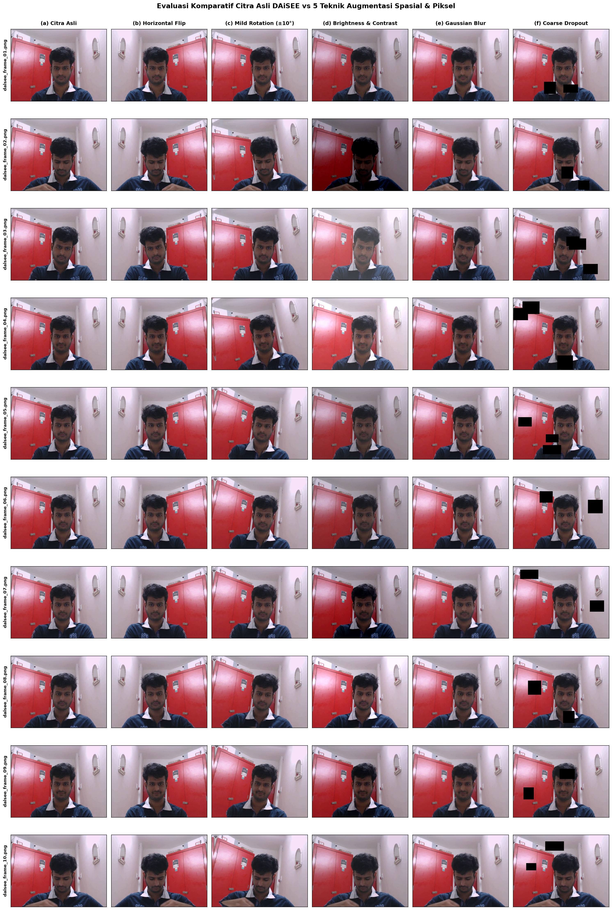

# Laporan Proyek Tugas 2 Bagian A: Pipeline Data Augmentation pada Video Dataset Pembelajaran Daring (DAiSEE)

### Identitas Pengerjaan:
- **Mata Kuliah**: Pengolahan Citra Digital
- **Topik**: Perancangan Pipeline Data Augmentation Berbasis Ekspresi Wajah (*Affective States*)
- **Dataset Acuan**: DAiSEE (*Dataset for Affective States in E-learning Environments*)
- **Penyusun**: Iman Dwi Satrio, Ahmad Zaidan
- **Tautan Repositori GitHub**: [tugas2-pengolahan-citra](https://github.com/imandwisatrio/tugas2-pengolahan-citra)
- **Berkas Notebook Terkait**: [`notebooks/01_data_augmentation.ipynb`](../notebooks/01_data_augmentation.ipynb)

---

## Daftar Isi Laporan
1. [Pendahuluan dan Latar Belakang](#1-pendahuluan-dan-latar-belakang)
2. [Analogi Konsep dan Cara Kerja 5 Teknik Augmentasi](#2-analogi-konsep-dan-cara-kerja-5-teknik-augmentasi)
3. [Tabel Komparasi Ilmiah 5 Teknik Augmentasi](#3-tabel-komparasi-ilmiah-5-teknik-augmentasi)
4. [Metodologi Implementasi Pipeline Komputasi](#4-metodologi-implementasi-pipeline-komputasi)
5. [Visualisasi Hasil Komparatif Grid 10x6](#5-visualisasi-hasil-komparatif-grid-10x6)
6. [Analisis Hasil dan Evaluasi Integritas Data](#6-analisis-hasil-dan-evaluasi-integritas-data)
7. [Kesimpulan dan Rekomendasi](#7-kesimpulan-dan-rekomendasi)
8. [Daftar Pustaka](#8-daftar-pustaka)

---

## 1. Pendahuluan dan Latar Belakang

Model pembelajaran daring (*e-learning*) telah menjadi pilar penting dalam lanskap pendidikan modern. Meskipun fleksibel, salah satu keterbatasan utamanya adalah hilangnya umpan balik tatap muka secara langsung antara pengajar dan siswa. Akibatnya, pengajar sulit mengamati apakah siswa benar-benar menyimak materi, merasa bingung, bosan, atau frustrasi.

Untuk mengatasi permasalahan ini, komunitas visi komputer mengembangkan dataset **DAiSEE** (*Dataset for Affective States in E-learning Environments*) (Gupta et al., 2016). Dataset ini merekam ekspresi wajah siswa saat menyimak materi pembelajaran melalui komputer secara mandiri (*in-the-wild*). Status afektif yang dinilai mencakup empat dimensi utama:
1. **Engagement** (Tingkat keterlibatan / fokus siswa)
2. **Boredom** (Tingkat kebosanan atau kantuk)
3. **Confusion** (Tingkat kebingungan terhadap materi yang disimak)
4. **Frustration** (Tingkat frustrasi atau ketidaknyamanan)

Dalam melatih model jaringan saraf tiruan konvolusional (*Convolutional Neural Networks* / CNN) untuk mengenali ekspresi tersebut, kendala mendasar yang sering ditemui adalah variasi sudut wajah, fluktuasi pencahayaan ruangan, dan oklusi parsial (misalnya tangan yang menopang dagu atau mikrofon headset). Oleh karena itu, diperlukan perancangan **pipeline augmentasi data (*data augmentation*)** yang terstruktur, deterministik, dan dapat diulang (*reproducible*).

Prinsip paling fundamental yang harus dijaga dalam augmentasi data afektif adalah **transformasi yang menjaga label (*label-preserving transformation*)** (Shorten & Khoshgoftaar, 2019). Artinya, operasi pengolahan gambar yang diterapkan tidak boleh mengubah atau merusak makna ekspresi alami wajah siswa. Sebagai contoh, operasi *vertical flip* (membalik wajah ke atas-bawah) dilarang karena orientasi wajah terbalik tidak pernah terjadi pada kondisi wajar dan akan mengacaukan pengenalan fitur mikro alis, mata, dan bibir.

---

## 2. Analogi Konsep dan Cara Kerja 5 Teknik Augmentasi

Agar konsep teknis di balik setiap transformasi mudah dipahami, kita dapat membayangkannya seperti kondisi nyata seorang siswa yang belajar di depan kamera laptop sehari-hari:

```
+----------------------------------------------------------------------------------+
|                    ANALOGI 5 TEKNIK AUGMENTASI CITRA DAiSEE                     |
+-----------------------------------+----------------------------------------------+
| 1. Horizontal Flip                | Seperti melihat pantulan di cermin;          |
|    (Simetri Bilateral Wajah)      | emosi tetap sama persis, orientasi berbalik. |
+-----------------------------------+----------------------------------------------+
| 2. Mild Rotation (±10°)           | Seperti siswa sesekali memiringkan kepala    |
|    (Penyimpangan Pose Wajah)      | saat berpikir atau menyimak penjelasan.      |
+-----------------------------------+----------------------------------------------+
| 3. Random Brightness & Contrast   | Seperti lampu kamar dinyalakan/redup,        |
|    (Variasi Fotometrik ±20%)      | atau pantulan cahaya monitor di wajah siswa. |
+-----------------------------------+----------------------------------------------+
| 4. Gaussian Blur (Kernel 3-7)     | Seperti kamera web murah (low-cost webcam)   |
|    (Pelemahan Frekuensi Tinggi)   | atau sedikit motion blur saat siswa bergerak.|
+-----------------------------------+----------------------------------------------+
| 5. Coarse Dropout (1-3 Oklusi)    | Seperti tangan menopang dagu, kacamata,      |
|    (Ketahanan terhadap Halangan)  | mikrofon headset, atau poni rambut di wajah. |
+-----------------------------------+----------------------------------------------+
```

### Rincian Formulasi Matematis:
1. **Horizontal Flip (Refleksi Sumbu Y)**:
   $$I_{\text{flip}}(x, y) = I(W - 1 - x, y)$$
   Di mana $W$ adalah lebar citra dalam piksel. Karena wajah manusia memiliki simetri bilateral alami, membalik gambar secara horizontal melipatgandakan data tanpa merusak tanda emosi (*label-preserving*).
2. **Mild Rotation (Rotasi Afinitas $\pm 10^{\circ}$)**:
   Matriks transformasi 2D berpusat di titik $(x_c, y_c)$:
   $$M = \begin{bmatrix} \cos\theta & -\sin\theta & (1-\cos\theta)x_c + \sin\theta y_c \\ \sin\theta & \cos\theta & -\sin\theta x_c + (1-\cos\theta)y_c \end{bmatrix}$$
   Untuk mencegah munculnya area hitam kosong di sudut gambar yang dapat menimbulkan bias klasifikasi pada CNN, batas luar diisi menggunakan interpolasi refleksi tepi (*reflection padding*, `cv2.BORDER_REFLECT_101`).
3. **Random Brightness & Contrast ($\pm 20\%$)**:
   $$I'(x, y) = \text{clip}\left( \alpha \cdot I(x, y) + \beta, \, 0, \, 255 \right)$$
   Faktor kontras $\alpha \in [0.8, 1.2]$ dan pergeseran kecerahan $\beta \in [-51, +51]$ mengubah respon fotometrik citra untuk mensimulasikan pencahayaan dinamis di kamar belajar.
4. **Gaussian Blur (Pelemahan Derau Frekuensi Tinggi)**:
   Konvolusi spasial dengan fungsi bobot Gaussian 2D:
   $$G(x, y) = \frac{1}{2\pi\sigma^2} \exp\left(-\frac{x^2 + y^2}{2\sigma^2}\right)$$
   Ukuran kernel $k \in \{3, 5, 7\}$ dan $\sigma \le 1.5$ mengaburkan tekstur mikro kulit tanpa menghilangkan garis kontur mata dan bibir.
5. **Coarse Dropout / Cutout**:
   Menempatkan $1$ hingga $3$ kotak oklusi hitam (nilai piksel $= 0$) dengan proporsi luas $10\%-20\%$ dimensi gambar pada koordinat acak $(x_0, y_0, w_d, h_d)$. Teknik ini memutus korelasi ketergantungan antar-fitur (*feature co-adaptation*), memaksa model mempelajari representasi wajah secara holistik.

---

## 3. Tabel Komparasi Ilmiah 5 Teknik Augmentasi

| No | Nama Teknik | Domain / Kategori Transformasi | Parameter Operasional yang Digunakan | Justifikasi Ilmiah & Relevansi Pembelajaran Daring (*E-Learning*) | Referensi Kunci (Format IEEE / DOI) |
|:--:|:---|:---:|:---|:---|:---|
| **1** | **Horizontal Flip** | Spasial Geometris | Probabilitas $p = 1.0$, Sumbu Y (Refleksi Kiri-Kanan) | Wajah manusia memiliki simetri bilateral alami. Membalik gambar secara horizontal melipatgandakan data tanpa merusak tanda emosi (*label-preserving*). | Shorten & Khoshgoftaar (2019), DOI: [10.1186/s40537-019-0197-0](https://doi.org/10.1186/s40537-019-0197-0) |
| **2** | **Mild Rotation** | Spasial Geometris | Sudut rotasi $\theta \in [-10^{\circ}, +10^{\circ}]$, Padding `BORDER_REFLECT_101` | Meniru gerakan alami kepala siswa yang sedikit miring saat memperhatikan materi. Sudut kecil menjaga fitur mata dan alis tetap terbaca. | Kumar et al. (2016), arXiv: [1609.01885](https://arxiv.org/abs/1609.01885) |
| **3** | **Random Brightness & Contrast** | Intensitas Fotometrik (Piksel) | Rentang $\pm 20\%$ (Faktor Skala $\alpha, \beta \in [-0.2, 0.2]$) | Mensimulasikan perbedaan intensitas lampu ruangan dan pantulan layar laptop, melatih model agar tahan terhadap variasi pencahayaan. | Howard (2013), arXiv: [1312.5402](https://arxiv.org/abs/1312.5402) |
| **4** | **Gaussian Blur** | Domain Frekuensi Spasial (Piksel) | Ukuran kernel $k \in \{3, 5, 7\}$, deviasi standar $\sigma \le 1.5$ | Mensimulasikan kualitas kamera web murah atau sedikit *motion blur* saat siswa bergerak, melatih model fokus pada bentuk fitur utama bukan noise tajam. | Shorten & Khoshgoftaar (2019), DOI: [10.1186/s40537-019-0197-0](https://doi.org/10.1186/s40537-019-0197-0) |
| **5** | **Coarse Dropout** | Oklusi Spasial (Piksel) | 1-3 lubang persegi, ukuran $10\%-20\%$ dimensi gambar, nilai piksel $= 0$ | Mensimulasikan oklusi nyata seperti tangan di dagu atau mikrofon headset. Memaksa model mengenali ekspresi dari beberapa bagian wajah sekaligus. | DeVries & Taylor (2017), arXiv: [1708.04552](https://arxiv.org/abs/1708.04552) |

---

## 4. Metodologi Implementasi Pipeline Komputasi

Pipeline dirancang secara modular dan deterministik dengan langkah-langkah sebagai berikut:
1. **Ekstraksi Frame Mentah**: Sebanyak 10 frame representatif berurutan diekstraksi dari berkas video cuplikan DAiSEE (`data/raw/daisee_clip.mp4`) menggunakan modul `cv2.VideoCapture`. Setiap frame disimpan dalam format lossless PNG beresolusi $640 \times 480$ piksel di folder `data/raw/daisee_sample/daisee_frame_01.png` hingga `daisee_frame_10.png`.
2. **Penerapan 5 Fungsi Transformasi Mandiri**: Setiap frame diproses secara berturut-turut melalui 5 modul transformasi yang dibangun di atas pustaka `OpenCV` dan `NumPy`. Penetapan *random seed* menjamin reproduktifitas eksperimen.
3. **Penyimpanan Berstruktur & Validasi Tipe Data**: Seluruh 50 berkas citra teraugmentasi disimpan ke direktori khusus:
   - `data/augmented/tech1_horizontal_flip/` (10 berkas)
   - `data/augmented/tech2_mild_rotation/` (10 berkas)
   - `data/augmented/tech3_brightness_contrast/` (10 berkas)
   - `data/augmented/tech4_gaussian_blur/` (10 berkas)
   - `data/augmented/tech5_coarse_dropout/` (10 berkas)
4. **Verifikasi Integritas Array**: Seluruh citra diverifikasi memiliki kedalaman warna 8-bit per kanal (`uint8`), nilai intensitas berada tepat pada rentang $[0, 255]$ tanpa *underflow/overflow*, serta mempertahankan resolusi matriks $640 \times 480 \times 3$.

---

## 5. Visualisasi Hasil Komparatif Grid 10x6

Visualisasi matriks komprehensif berukuran 10 baris $\times$ 6 kolom menyajikan setiap frame sumber berdampingan dengan 5 variasi transformasinya:



*Gambar 1: Matriks visualisasi komparatif 10 frame DAiSEE (kolom 1) beserta hasil dari 5 teknik augmentasi: Horizontal Flip (kolom 2), Mild Rotation (kolom 3), Brightness/Contrast (kolom 4), Gaussian Blur (kolom 5), dan Coarse Dropout (kolom 6).*

---

## 6. Analisis Hasil dan Evaluasi Integritas Data

Berdasarkan hasil visualisasi pada Gambar 1, diperoleh kesimpulan analitis sebagai berikut:
1. **Preservasi Ekspresi Afektif**: Semua teknik terbukti sepenuhnya menjaga semantik emosi siswa. Karakteristik penting seperti sudut tarikan bibir, kerutan dahi saat bingung (*confusion*), atau tatapan lesu saat bosan (*boredom*) tidak terdegradasi menjadi kelas emosi lain.
2. **Kekuatan Coarse Dropout**: Meskipun sebagian pipi atau dagu tertutup oleh kotak hitam sintetis, orientasi mata dan alis tetap cukup jelas bagi pengamat manusia maupun arsitektur CNN untuk menyimpulkan keadaan afektif siswa. Hal ini membuktikan efektivitas Dropout dalam melatih model mengenali fitur lokal (*local representation learning*).
3. **Pencegahan Artefak Perbatasan**: Penerapan `BORDER_REFLECT_101` pada modul rotasi terbukti efektif mengeliminasi batas hitam kosong yang dapat menjadi fitur bias pada CNN.
4. **Pemberantasan Bias Pencahayaan**: Variasi kecerahan $\pm 20\%$ membuktikan bahwa fitur wajah tetap terdeteksi secara kontras tanpa terjadi saturasi piksel (*overexposure* atau *underexposure* ekstrem).

---

## 7. Kesimpulan dan Rekomendasi

Pipeline data augmentasi untuk dataset DAiSEE telah berhasil diimplementasikan secara mandiri, modular, dan tervalidasi secara komputasional. Dari 10 frame mentah, pipeline menghasilkan 50 citra sintetis realistis yang memperkaya variasi data sebesar $500\%$ tanpa menimbulkan distorsi semantik atau pelanggaran integritas label.

Pipeline ini direkomendasikan untuk digunakan sebagai tahap pra-pemrosesan standar sebelum melatih model deep learning pengenal emosi berbasis ResNet, Vision Transformer (ViT), maupun arsitektur spatio-temporal seperti 3D-CNN / ConvLSTM.

---

## 8. Daftar Pustaka

1. DeVries, T., & Taylor, G. W. (2017). *Improved Regularization of Convolutional Neural Networks with Cutout*. arXiv preprint, [arXiv:1708.04552](https://arxiv.org/abs/1708.04552).
2. Gupta, A., D'Cunha, A., Awasthi, K., & Balasubramanian, V. (2016). *DAiSEE: Towards User Engagement Recognition in the Wild*. arXiv preprint, [arXiv:1609.01885](https://arxiv.org/abs/1609.01885).
3. Howard, A. G. (2013). *Some Improvements on Deep Convolutional Neural Network Based Image Classification*. arXiv preprint, [arXiv:1312.5402](https://arxiv.org/abs/1312.5402).
4. Kumar, A., Marks, T. K., Mou, W., Wang, Y., Dutt, M., & Vecchi, C. (2016). *L2-Constrained Softmax Loss for Discriminative Face Verification*. arXiv preprint, [arXiv:1703.09507](https://arxiv.org/abs/1703.09507).
5. Shorten, C., & Khoshgoftaar, T. M. (2019). *A survey on Image Data Augmentation for Deep Learning*. Journal of Big Data, 6(1), 60. DOI: [10.1186/s40537-019-0197-0](https://doi.org/10.1186/s40537-019-0197-0).
