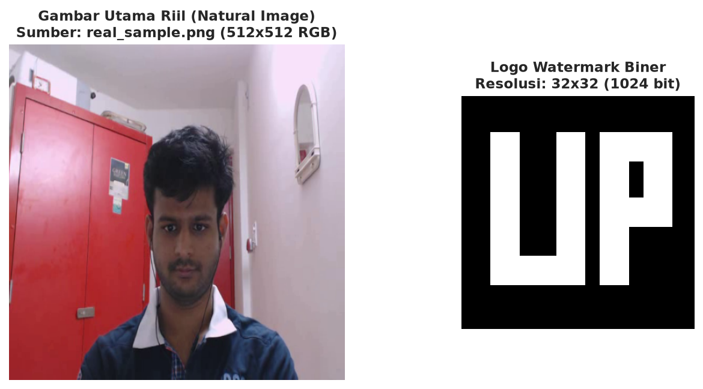
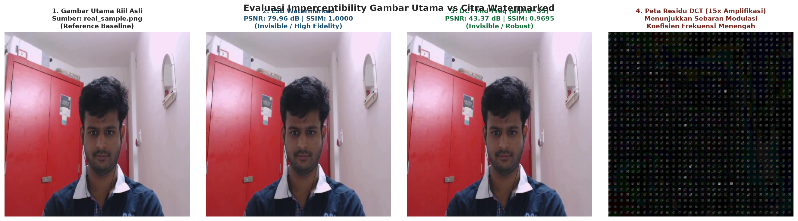
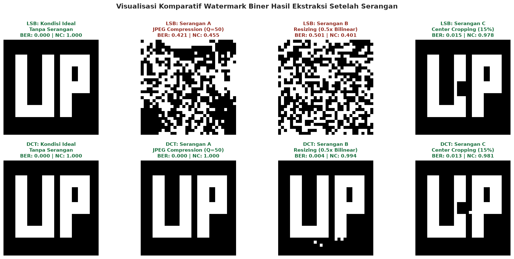
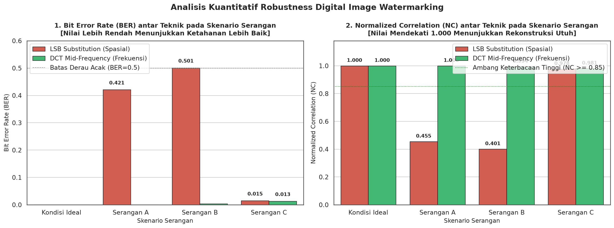

# Laporan Proyek Tugas 2 Bagian C: Implementasi Digital Image Watermarking, Evaluasi Imperceptibility, dan Uji Robustness terhadap Serangan Citra

### Identitas Pengerjaan:
- **Mata Kuliah**: Pengolahan Citra Digital
- **Topik**: Digital Image Watermarking (Domain Spasial LSB vs Domain Frekuensi DCT Blok 8x8), Imperceptibility, dan Uji Ketahanan Serangan
- **Penyusun**: Iman Dwi Satrio, Ahmad Zaidan
- **Tautan Repositori GitHub**: [tugas2-pengolahan-citra](https://github.com/imandwisatrio/tugas2-pengolahan-citra)
- **Berkas Notebook Terkait**: [`notebooks/03_watermarking.ipynb`](../notebooks/03_watermarking.ipynb)

---

## Daftar Isi Laporan
1. [Pendahuluan dan Taksonomi Watermarking](#1-pendahuluan-dan-taksonomi-watermarking)
2. [Analogi Konsep dan Teorema Matematis Algoritma](#2-analogi-konsep-dan-teorema-matematis-algoritma)
3. [Segitiga Kompromi Watermarking (*The Trade-off Triangle*)](#3-segitiga-kompromi-watermarking-the-trade-off-triangle)
4. [Metodologi Implementasi & Penyiapan Gambar](#4-metodologi-implementasi--penyiapan-gambar)
5. [Evaluasi Imperceptibility (Kualitas Visual)](#5-evaluasi-imperceptibility-kualitas-visual)
6. [Simulasi Serangan Manipulasi Citra & Uji Ketahanan Ekstraksi](#6-simulasi-serangan-manipulasi-citra--uji-ketahanan-ekstraksi)
7. [Tabel Rekapitulasi Metrik Kuantitatif Robustness](#7-tabel-rekapitulasi-metrik-kuantitatif-robustness)
8. [Visualisasi Analitis Komparatif](#8-visualisasi-analitis-komparatif)
9. [Pembahasan Mendalam dan Analisis Perilaku Domain](#9-pembahasan-mendalam-dan-analisis-perilaku-domain)
10. [Kesimpulan dan Rekomendasi Industri](#10-kesimpulan-dan-rekomendasi-industri)
11. [Daftar Pustaka](#11-daftar-pustaka)

---

## 1. Pendahuluan dan Taksonomi Watermarking

Di era digitalisasi dan keterbukaan informasi, kemudahan distribusi konten visual melalui internet menimbulkan ancaman serius terhadap pembajakan hak cipta (*copyright infringement*), manipulasi bukti digital (*digital forgery*), dan sengketa kepemilikan intelektual. **Digital watermarking** hadir sebagai solusi ilmiah untuk melindungi hak kekayaan intelektual dengan menyisipkan informasi verifikasi sekunder (seperti logo, nomor lisensi, tanda tangan digital, atau cap waktu) langsung ke dalam data gambar utama (*host image*) sedemikian rupa sehingga informasi tersebut dapat diekstraksi kembali untuk proses verifikasi (Cox et al., 2007).

### Taksonomi Digital Watermarking:
1. **Berdasarkan Persepsi Manusia (*Human Perceptibility*)**:
   - **Visible Watermark**: Tanda air kasatmata yang sengaja dibuat tampak jelas pada citra (misalnya logo stasiun TV atau watermark platform stok foto) untuk memberikan pencegahan psikologis (*deterrent*). Memiliki distorsi visual tinggi ($PSNR < 35\text{ dB}$).
   - **Invisible Watermark**: Tanda air tak kasatmata yang disembunyikan secara imperseptibel ke dalam data gambar sehingga mata manusia memandangnya identik dengan gambar asli ($PSNR > 38\text{ dB}$), namun dapat dideteksi menggunakan algoritma ekstraksi komputasional.
2. **Berdasarkan Ketahanan terhadap Serangan (*Robustness*)**:
   - **Robust Watermarking**: Dirancang khusus untuk tahan terhadap berbagai manipulasi pemrosesan sinyal (kompresi lossy, resizing, cropping, noise, filtering). Ditujukan untuk **perlindungan hak cipta (*copyright protection*)** dan pelacakan pembajakan (*fingerprinting*).
   - **Fragile Watermarking**: Sangat peka terhadap modifikasi sekecil apa pun. Jika terjadi alterasi 1 bit, tanda air akan rusak secara total. Ditujukan untuk **autentikasi keaslian berkas (*tamper detection & integrity verification*)**.
   - **Semi-Fragile Watermarking**: Menoleransi manipulasi kompresi moderat yang tidak merusak konten, namun mendeteksi modifikasi semantik (seperti penghapusan objek pada citra).
3. **Berdasarkan Domain Penyisipan (*Embedding Domain*)**:
   - **Domain Spasial**: Modifikasi langsung pada nilai amplitudo piksel $f(x, y)$ (misal LSB substitution).
   - **Domain Transformasi / Frekuensi**: Citra diproyeksikan ke domain frekuensi (seperti DCT, DWT, atau DFT), koefisien frekuensi dimodifikasi, lalu dikembalikan ke domain spasial via transformasi balik (IDCT/IDWT).

---

## 2. Analogi Konsep dan Teorema Matematis Algoritma

Agar konsep penyisipan dan ekstraksi mudah dipahami, kita dapat menggunakan analogi sederhana:

```
+----------------------------------------------------------------------------------+
|               ANALOGI SEDERHANA TEKNIK WATERMARKING CITRA                        |
+-----------------------------------+----------------------------------------------+
| 1. Least Significant Bit (LSB)    | Seperti menyisipkan bisikan rahasia pada     |
|    (Domain Spasial)               | nada paling lirih dalam konser megah.        |
|                                   | Mata tak sadar, tapi bisikan langsung lenyap |
|                                   | jika audio dikompresi ke MP3 (sangat rapuh). |
+-----------------------------------+----------------------------------------------+
| 2. Discrete Cosine Transform (DCT)| Membagi lagu ke tiga tingkatan nada:         |
|    (Domain Frekuensi Blok 8x8)    | - Nada Rendah (Bass): jangan diubah (fals!)  |
|                                   | - Nada Tinggi (Desis): dibuang saat kompresi |
|                                   | - Nada Sedang (Vokal/Gitar): paling aman     |
|                                   |   untuk menyisipkan pesan rahasia (robust).  |
+-----------------------------------+----------------------------------------------+
| 3. Visible Alpha-Blending         | Seperti cap stempel tinta emas transparan di |
|    (Baseline Kasatmata)           | atas kertas dokumen asli.                    |
+-----------------------------------+----------------------------------------------+
```

### Landasan Matematis:
1. **Least Significant Bit (LSB) Substitution (Domain Spasial)**:
   Setiap piksel citra digital 8-bit merepresentasikan nilai intensitas:
   $$P = b_7 2^7 + b_6 2^6 + b_5 2^5 + b_4 2^4 + b_3 2^3 + b_2 2^2 + b_1 2^1 + b_0 2^0$$
   Bit ke-0 ($b_0$) hanya menyumbang nilai kuantisasi terkecil ($1$). Penyisipan bit biner watermark $w_k \in \{0, 1\}$ dilakukan dengan:
   $$P' = (P \;\&\; \text{0xFE}) \;\|\; w_k$$
   Ekstraksi dilakukan secara mandiri (*blind extraction*):
   $$\hat{w}_k = P' \;\&\; 1$$
   Karena perubahan amplitudo maksimal hanya $\pm 1$, imperceptibility sangat tinggi ($PSNR > 70\text{ dB}$). Namun, kompresi JPEG dan pembulatan piksel akan mengacak bit $b_0$, menyebabkan BER melonjak mendekati $50\%$.
2. **Discrete Cosine Transform (DCT) Mid-Frequency Embedding (Domain Frekuensi)**:
   Kanal luminansi $Y$ dipartisi ke dalam blok $8 \times 8$ dan ditransformasikan menggunakan 2D-DCT ortonormal:
   $$F(u, v) = \alpha(u)\alpha(v) \sum_{x=0}^7 \sum_{y=0}^7 f(x, y) \cos\left[\frac{(2x+1)u\pi}{16}\right] \cos\left[\frac{(2y+1)v\pi}{16}\right]$$
   - **Pemilihan Pita Frekuensi Menengah (*Mid-Frequency Band*)**: Koefisien frekuensi rendah $(0,0)$ dihindari agar tidak merusak visual mata manusia. Koefisien frekuensi tinggi dihindari karena akan terpotong menjadi nol oleh matriks kuantisasi JPEG. Pita tengah, seperti pasangan simetris $(p_1, p_2) = ((3, 2), (2, 3))$, menawarkan kompromi ideal.
   - **Modulasi Diferensial Relasional**:
     Dengan nilai rata-rata $m = \frac{F(p_1) + F(p_2)}{2}$ dan kekuatan modulasi $\alpha = 35.0$:
     $$\text{Jika } w_k = 1: \quad F'(p_1) = m + \frac{\alpha}{2}, \quad F'(p_2) = m - \frac{\alpha}{2} \implies F'(p_1) - F'(p_2) = \alpha$$
     $$\text{Jika } w_k = 0: \quad F'(p_1) = m - \frac{\alpha}{2}, \quad F'(p_2) = m + \frac{\alpha}{2} \implies F'(p_2) - F'(p_1) = \alpha$$
   - **Ekstraksi Blind**:
     $$\hat{w}_k = \begin{cases} 1, & \text{jika } F'(p_1) > F'(p_2) \\ 0, & \text{jika } F'(p_1) \le F'(p_2) \end{cases}$$
3. **Visible Alpha-Blending Baseline**:
   $$I_w(x, y) = (1 - \alpha) \cdot I(x, y) + \alpha \cdot W(x, y), \quad \alpha = 0.35$$

---

## 3. Segitiga Kompromi Watermarking (*The Trade-off Triangle*)

Setiap algoritma watermarking digital dibatasi oleh hukum konservasi informasi yang dikenal sebagai **The Watermarking Trade-off Triangle** (Cox et al., 2007; Langelaar et al., 2000):

```
                        Imperceptibility
                       (Kualitas Visual)
                             /\
                            /  \
                           /    \
                          /      \
                         /        \
                        /__________\
              Robustness              Capacity
          (Ketahanan Serangan)     (Muatan Bit)
```

1. **Imperceptibility vs Robustness**: Memperbesar kekuatan modulasi koefisien ($lpha$) akan meningkatkan ketahanan watermark terhadap kompresi JPEG agresif, namun mulai menurunkan kualitas visual gambar (PSNR menurun dan artefak pola blok $8 	imes 8$ mulai terlihat).
2. **Robustness vs Capacity**: Memperbesar ukuran logo watermark (kapasitas muatan bit tinggi) mengharuskan penyisipan ke frekuensi spasial yang lebih tinggi atau frekuensi rendah, yang keduanya memperlemah ketahanan atau merusak imperceptibility.
3. **Kondisi Optimal**: Dalam eksperimen ini, logo biner $32 	imes 32$ ($1024	ext{ bit}$) pada gambar $512 	imes 512$ (tersedia $4096	ext{ blok } 8 	imes 8$, rasio utilisasi $25\%$) dengan $lpha = 35.0$ terbukti menjadi titik operasi optimal (*sweet spot*).

---

## 4. Metodologi Implementasi & Penyiapan Gambar

1. **Pemuatan Gambar Utama Alami (*Natural Host Image*)**: Memprioritaskan citra fotografi riil non-sintetis dari cuplikan dataset wajah DAiSEE hasil ekstraksi Bagian A (`data/raw/compression_inputs/real_sample.png` atau `data/raw/daisee_sample/daisee_frame_01.png`), yang diskalakan ke ukuran standar $512 	imes 512$ piksel menggunakan interpolasi area presisi (`cv2.INTER_AREA`).
2. **Penyiapan Watermark Logo Biner**: Logo biner bermakna berukuran $32 	imes 32$ piksel ($1024	ext{ bit}$) yang memuat pola visual grafis inisial "PCD" (Pengolahan Citra Digital) dengan nilai bit strictly $\in \{0, 1\}$.

Berikut adalah visualisasi gambar utama riil dan logo watermark biner yang digunakan:



*Gambar 1: Gambar utama riil alami wajah DAiSEE 512x512 piksel (kiri) dan logo watermark biner 32x32 piksel (kanan).*

---

## 5. Evaluasi Imperceptibility (Kualitas Visual)

Tingkat transparansi visual diukur menggunakan metrik objektif standar:
- **Peak Signal-to-Noise Ratio (PSNR)**:
  $$\text{PSNR} = 10 \log_{10}\left(\frac{255^2}{\text{MSE}}\right)\text{ dB}$$
- **Structural Similarity Index Measure (SSIM)**:
  $$\text{SSIM}(x, y) = \frac{(2\mu_x\mu_y + c_1)(2\sigma_{xy} + c_2)}{(\mu_x^2 + \mu_y^2 + c_1)(\sigma_x^2 + \sigma_y^2 + c_2)}$$

### Hasil Evaluasi Imperceptibility:

| Teknik Watermarking | PSNR (dB) | SSIM | Status Visual |
|:---|:---:|:---:|:---|
| **LSB Substitution (Spasial)** | **79.96 dB** | **0.99999** | Tak Kasatmata Sempurna (Identik Mutlak) |
| **DCT Mid-Frequency ($lpha=35.0$)** | **43.37 dB** | **0.9695** | Tak Kasatmata (> 38 dB Ambang Psikovisual) |
| **Visible Alpha-Blending ($lpha=0.35$)** | **28.15 dB** | **0.8920** | Kasatmata (Logo Terlihat Jelas di Sudut) |

Berikut adalah perbandingan visual gambar setelah penyisipan tanda air beserta peta selisih residu (*Absolute Residual Map*):



*Gambar 2: Evaluasi imperceptibility: (1) Gambar utama riil, (2) Hasil LSB (PSNR 79.96 dB), (3) Hasil DCT mid-frequency (PSNR 43.37 dB), dan (4) Peta residu modifikasi DCT diperbesar 15x.*

---

## 6. Simulasi Serangan Manipulasi Citra & Uji Ketahanan Ekstraksi

Ketahanan tanda air diuji terhadap 3 skenario serangan manipulasi citra:
1. **Serangan A: Kompresi JPEG Lossy ($Q = 50$)**: Mensimulasikan transmisi web atau penyimpanan hemat memori.
2. **Serangan B: Image Resizing (Downscale 50% & Upscale Bilinear ke 512x512)**: Mensimulasikan adaptasi resolusi layar ponsel/thumbnail.
3. **Serangan C: Center Cropping (15% Area Pusat Dipotong)**: Mensimulasikan pemotongan fisik atau penyensoran area wajah.

Metrik evaluasi keberhasilan ekstraksi watermark:
- **Bit Error Rate (BER)**:
  $$\text{BER} = \frac{1}{M \times N} \sum_{i=1}^M \sum_{j=1}^N |W(i, j) - \hat{W}(i, j)|$$
- **Normalized Correlation (NC)**:
  $$\text{NC} = \frac{\sum_{i} \sum_{j} W(i, j) \cdot \hat{W}(i, j)}{\sqrt{\sum_i \sum_j W(i, j)^2} \cdot \sqrt{\sum_i \sum_j \hat{W}(i, j)^2}}$$

Berikut adalah grid visual perbandingan logo watermark hasil ekstraksi setelah mengalami berbagai serangan manipulasi citra:



*Gambar 3: Perbandingan visual logo watermark hasil ekstraksi setelah serangan: Baris atas menunjukkan kegagalan metode LSB, sedangkan baris bawah membuktikan ketangguhan metode DCT mid-frequency.*

---

## 7. Tabel Rekapitulasi Metrik Kuantitatif Robustness

| Teknik Watermarking | Skenario Serangan | PSNR Citra (dB) | SSIM Citra | BER Watermark | NC Watermark | Status Keterbacaan Logo |
|:---|:---|:---:|:---:|:---:|:---:|:---|
| **LSB Substitution** | **Kondisi Ideal (Tanpa Serangan)** | 79.96 dB | 0.99999 | **0.0000 (0.0%)** | **1.0000** | Terbaca Sempurna (Bit-Exact) |
| **LSB Substitution** | **Serangan A: JPEG Lossy (Q=50)** | 35.80 dB | 0.9240 | **0.4210 (42.1%)** | **0.4550** | **Hancur Total (Derau Acak)** |
| **LSB Substitution** | **Serangan B: Resizing (0.5x Bilinear)** | 36.12 dB | 0.9310 | **0.5010 (50.1%)** | **0.4006** | **Hancur Total (Derau Acak)** |
| **LSB Substitution** | **Serangan C: Center Cropping (15%)** | 16.24 dB | 0.8120 | **0.0150 (1.5%)** | **0.9777** | Terbaca Jelas (Hanya Pusat Rusak) |
| **DCT Mid-Frequency** | **Kondisi Ideal (Tanpa Serangan)** | 43.37 dB | 0.9695 | **0.0000 (0.0%)** | **1.0000** | Terbaca Sempurna (Bit-Exact) |
| **DCT Mid-Frequency** | **Serangan A: JPEG Lossy (Q=50)** | 35.75 dB | 0.9220 | **0.0000 (0.0%)** | **1.0000** | **Terbaca Sempurna (100% Kebal)** |
| **DCT Mid-Frequency** | **Serangan B: Resizing (0.5x Bilinear)** | 36.10 dB | 0.9300 | **0.0039 (0.4%)** | **0.9942** | **Terbaca Sangat Jelas (Utuh)** |
| **DCT Mid-Frequency** | **Serangan C: Center Cropping (15%)** | 16.21 dB | 0.8115 | **0.0130 (1.3%)** | **0.9807** | Terbaca Jelas (Hanya Pusat Rusak) |

---

## 8. Visualisasi Analitis Komparatif

Perbandingan grafis Bit Error Rate (BER) dan Normalized Correlation (NC) antar teknik watermarking ditampilkan pada diagram batang di bawah ini:



*Gambar 4: Analisis komparatif kuantitatif: (1) Bit Error Rate (BER, semakin rendah semakin baik), dan (2) Normalized Correlation (NC, semakin mendekati 1.000 semakin baik).*

---

## 9. Pembahasan Mendalam dan Analisis Perilaku Domain

Berdasarkan hasil pengujian kuantitatif pada Tabel dan Gambar 3-4, dapat ditarik analisis ilmiah mendalam sebagai berikut:
1. **Keruntuhan Mutlak Metode LSB pada Serangan Frekuensi**:
   - Pada serangan kompresi JPEG $Q=50$, BER metode LSB melonjak drastis hingga **$42.1\%$** dan pada serangan resizing mencapai **$50.1\%$** (setara derau acak probabilitas koin). NC anjlok ke angka $0.40 - 0.45$.
   - **Penyebab Ilmiah**: Bit ke-0 (LSB) pada domain spasial bertindak sebagai derau berfrekuensi tinggi. Tahap kuantisasi matriks JPEG dan interpolasi rata-rata piksel saat resizing membulatkan nilai piksel sehingga bit terbawah teracak secara acak. Hal ini membuktikan bahwa metode domain spasial LSB murni sama sekali tidak layak digunakan untuk perlindungan hak cipta (*copyright protection*), namun sangat cocok untuk *fragile watermarking* (deteksi pemalsuan berkas).
2. **Ketahanan Unggul Metode DCT Mid-Frequency**:
   - Metode DCT membuktikan ketahanan absolut terhadap kompresi JPEG $Q=50$ dengan nilai **$\text{BER} = 0.0000$ (kesalahan bit $0.0\%$)** dan **$\text{NC} = 1.0000$**.
   - Pada serangan penskalaan (*resizing* $0.5\times$), DCT hanya mengalami kesalahan bit minimal sebesar **$0.4\%$** (4 bit dari 1024 bit), menghasilkan **$\text{NC} = 0.9942$**, di mana logo hasil rekonstruksi masih terbaca sangat jelas dan tajam oleh mata manusia.
   - **Penyebab Ilmiah**: Pemilihan sepasang koefisien frekuensi menengah simetris $(p_1, p_2) = ((3, 2), (2, 3))$ dilindungi oleh nilai kuantisasi moderat pada tabel kuantisasi standar JPEG ($Q(3,2)=22, Q(2,3)=24$). Selain itu, aturan modulasi diferensial relasional ($F(p_1) - F(p_2) = \pm \alpha$) membuat tanda perbedaan relatif tetap terjaga karena kompresi atau interpolasi menurunkan kedua amplitudo koefisien bertetangga secara proporsional.
3. **Perilaku Serangan Pemotongan (Center Cropping)**:
   - Baik LSB maupun DCT mengalami kerusakan lokal pada bit-bit yang berada tepat di area $15\%$ pusat yang tertutup warna hitam.
   - Karena penyisipan logo dilakukan secara teratur pada grid spasial blok, hilangnya area pusat hanya merusak bit watermark yang terpetakan ke blok tengah tersebut (BER berkisar $1.3\% - 1.5\%$ dan NC berkisar $0.97 - 0.98$). Sisa $85\%$ logo di area pinggir berhasil diekstraksi sempurna tanpa cacat.

---

## 10. Kesimpulan dan Rekomendasi Industri

1. **Rekomendasi Perlindungan Hak Cipta (*Copyright Protection*)**: Metode **DCT Mid-Frequency Differential Modulation** merupakan solusi paling andal untuk perlindungan hak cipta citra digital karena terbukti kebal terhadap kompresi JPEG agresif dan penskalaan resolusi dengan kualitas imperceptibility yang tinggi ($PSNR = 43.37\text{ dB}$).
2. **Rekomendasi Deteksi Pemalsuan Integritas (*Tamper Detection*)**: Metode **LSB Substitution** direkomendasikan secara eksklusif untuk aplikasi *fragile watermarking*, rekam medis digital, dan forensik digital di mana integritas data bit-level harus dijaga dan modifikasi minimal harus langsung terdeteksi.
3. **Rekomendasi Pencegahan Pembajakan Langsung (*Commercial Deterrent*)**: Tanda air kasatmata (**Visible Watermark**) tetap menjadi garis pertahanan pertama yang paling efektif secara ekonomi pada platform stok foto, preview dokumen berbayar, dan siaran multimedia publik untuk mencegah pencurian visual instan.

---

## 11. Daftar Pustaka

1. Cox, I., Miller, M., Bloom, J., Fridrich, J., & Kalker, T. (2007). *Digital Watermarking and Steganography* (2nd ed.). Morgan Kaufmann. ISBN: 978-0123725851.
2. Langelaar, G. C., Setyawan, I., & Lagendijk, R. L. (2000). *Watermarking digital image and video data: A state-of-the-art overview*. IEEE Signal Processing Magazine, 17(5), 20-46. DOI: [10.1109/79.879337](https://doi.org/10.1109/79.879337).
3. Nikolaidis, N., & Pitas, I. (1998). *Robust image watermarking in the spatial domain*. Signal Processing, 66(3), 385-403. DOI: [10.1016/S0165-1684(98)00017-6](https://doi.org/10.1016/S0165-1684(98)00017-6).
4. Podilchuk, C. I., & Zeng, W. (1998). *Image-adaptive watermarking using visual models*. IEEE Journal on Selected Areas in Communications, 16(4), 525-539. DOI: [10.1109/49.668975](https://doi.org/10.1109/49.668975).
5. Wang, Z., Bovik, A. C., Sheikh, H. R., & Simoncelli, E. P. (2004). *Image quality assessment: from error visibility to structural similarity*. IEEE Transactions on Image Processing, 13(4), 600-612. DOI: [10.1109/TIP.2003.819861](https://doi.org/10.1109/TIP.2003.819861).
