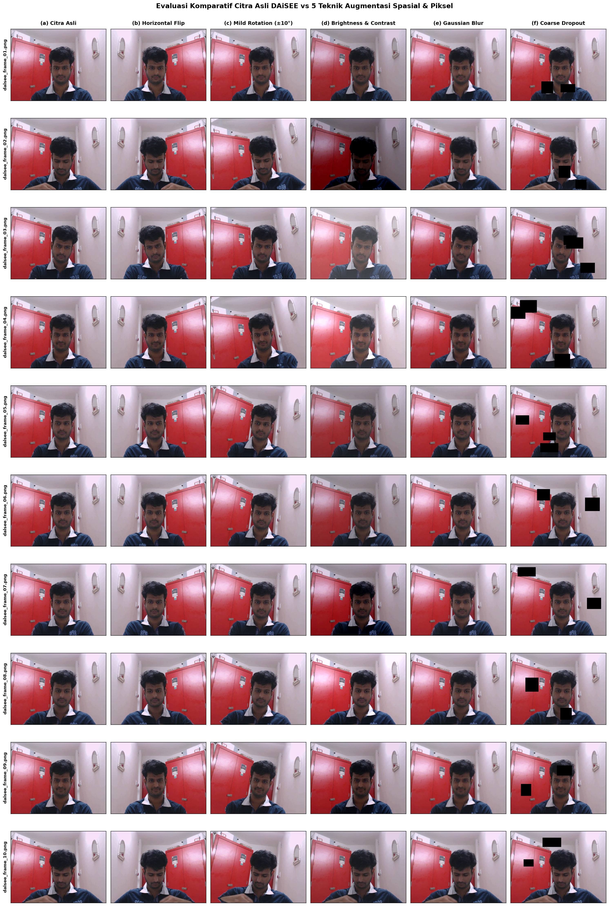
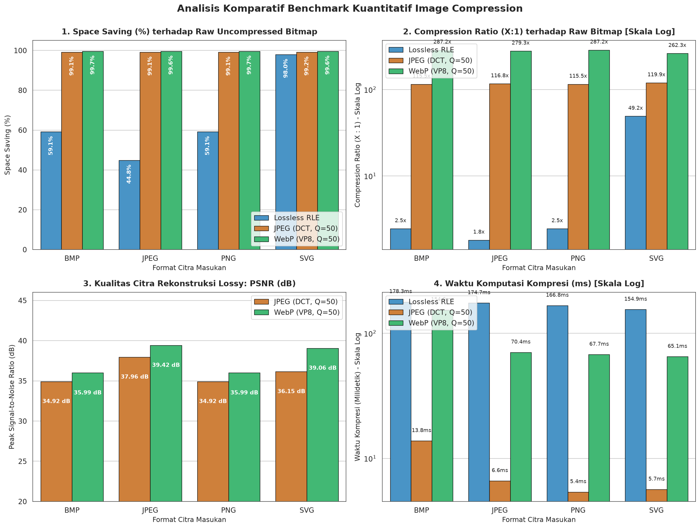
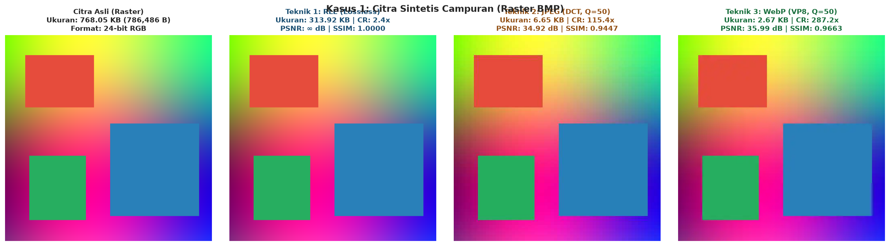
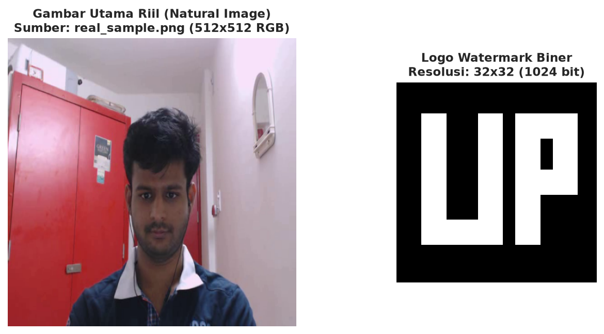
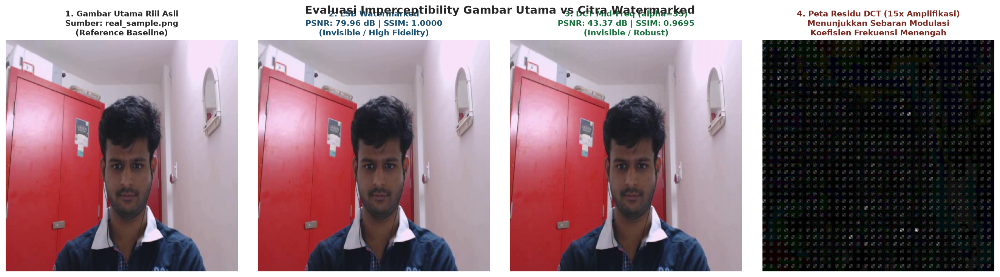
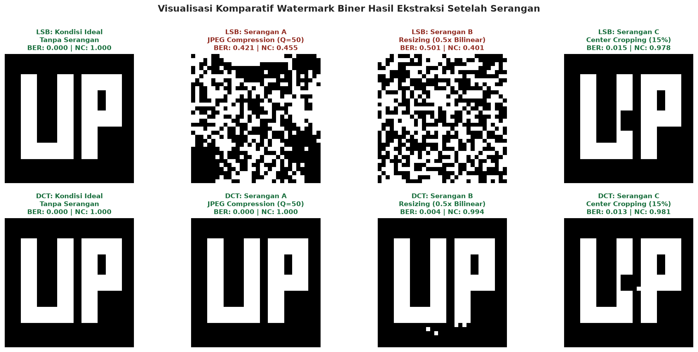
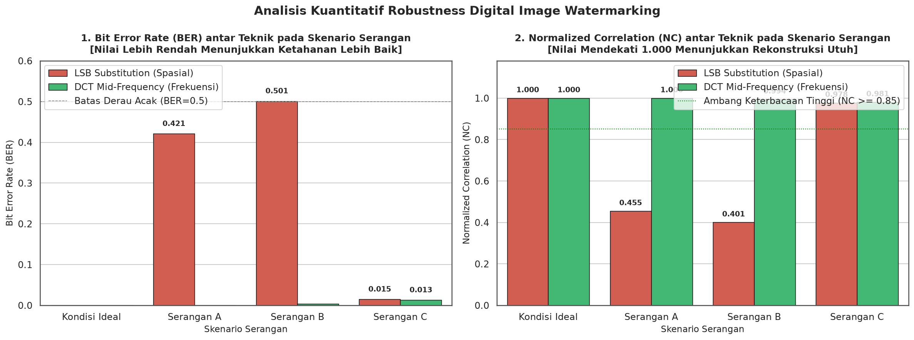

# Laporan Tugas 2: Pemrosesan Citra Tingkat Lanjut - Data Augmentation, Image Compression, dan Digital Watermarking

> **Mata Kuliah**: Pengolahan Citra Digital  
> **Penyusun**: Iman Dwi Satrio, Ahmad Zaidan  
> **Institusi**: Program Studi Informatika / Ilmu Komputer  
> **Tautan Repositori GitHub**: [tugas2-pengolahan-citra](https://github.com/imandwisatrio/tugas2-pengolahan-citra)  
> **Struktur Kode & Notebook**:
> - Bagian A (Data Augmentation): [`notebooks/01_data_augmentation.ipynb`](../notebooks/01_data_augmentation.ipynb)
> - Bagian B (Image Compression): [`notebooks/02_image_compression.ipynb`](../notebooks/02_image_compression.ipynb)
> - Bagian C (Digital Watermarking): [`notebooks/03_watermarking.ipynb`](../notebooks/03_watermarking.ipynb)

---

## Daftar Isi Lengkap

1. [Bab 1: Pendahuluan dan Latar Belakang Terpadu](#bab-1-pendahuluan-dan-latar-belakang-terpadu)
   - 1.1 Urgensi Pemrosesan Citra Tingkat Lanjut
   - 1.2 Keterkaitan Tiga Pilar: Variasi Model, Efisiensi Transmisi, dan Perlindungan Hak Cipta
   - 1.3 Tujuan Proyek dan Lingkup Eksperimen
2. [Bab 2: Bagian A - Pipeline Data Augmentation pada Video Dataset E-Learning (DAiSEE)](#bab-2-bagian-a---pipeline-data-augmentation-pada-video-dataset-e-learning-daisee)
   - 2.1 Konteks Dataset DAiSEE dan Tantangan Kondisi In-the-Wild
   - 2.2 Prinsip Transformasi Menjaga Label (*Label-Preserving*)
   - 2.3 Analogi Konseptual dan Cara Kerja 5 Teknik Augmentasi
   - 2.4 Formulasi Matematis Transformasi
   - 2.5 Tabel Komparasi Ilmiah 5 Teknik Augmentasi
   - 2.6 Implementasi Teknis dan Visualisasi Matriks 10x6
   - 2.7 Analisis Hasil dan Pembahasan Bagian A
3. [Bab 3: Bagian B - Analisis Komparatif Algoritma Image Compression dan Benchmarking Kuantitatif](#bab-3-bagian-b---analisis-komparatif-algoritma-image-compression-dan-benchmarking-kuantitatif)
   - 3.1 Teori Redundansi Data Citra Digital
   - 3.2 Analogi Konseptual dan Rangkuman Mendalam 10 Algoritma Kompresi
   - 3.3 Tabel Komparasi Komprehensif 10 Teknik Kompresi
   - 3.4 Kajian Khusus: Perlakuan & Rasterisasi Citra Vektor (SVG)
   - 3.5 Metodologi Implementasi 3 Teknik Terpilih (RLE, JPEG DCT, WebP)
   - 3.6 Tabel Rekapitulasi Hasil Benchmarking Multi-Format
   - 3.7 Visualisasi Kuantitatif dan Perbandingan Visual Hasil Rekonstruksi
   - 3.8 Analisis Trade-off Kualitas, Rasio, dan Waktu Komputasi
4. [Bab 4: Bagian C - Implementasi Digital Image Watermarking dan Uji Robustness terhadap Serangan Citra](#bab-4-bagian-c---implementasi-digital-image-watermarking-dan-uji-robustness-terhadap-serangan-citra)
   - 4.1 Definisi dan Taksonomi Digital Watermarking
   - 4.2 Analogi Konseptual dan Teorema Algoritma (LSB Spasial vs DCT Frekuensi)
   - 4.3 Segitiga Kompromi Watermarking (*The Trade-off Triangle*)
   - 4.4 Metodologi Implementasi pada Gambar Utama Alami
   - 4.5 Evaluasi Imperceptibility (PSNR, SSIM, dan Peta Residu)
   - 4.6 Pengujian Ketahanan (*Robustness*) terhadap Tiga Skenario Serangan
   - 4.7 Tabel Rekapitulasi Kuantitatif Metrik Ketahanan (BER dan NC)
   - 4.8 Visualisasi Logo Hasil Ekstraksi dan Grafik Kuantitatif
   - 4.9 Pembahasan Ilmiah Ketahanan Domain Frekuensi vs Kerapuhan Domain Spasial
5. [Bab 5: Kesimpulan Umum, Rekomendasi Praktis Industri, dan Arah Pengembangan](#bab-5-kesimpulan-umum-rekomendasi-praktis-industri-dan-arah-pengembangan)
   - 5.1 Sintesis Hasil Eksperimen Menyeluruh
   - 5.2 Panduan Rekomendasi Format dan Keamanan untuk Industri
   - 5.3 Keterbatasan Eksperimen dan Peluang Penelitian Mendatang
6. [Daftar Pustaka Lengkap](#daftar-pustaka-lengkap)

---

## Bab 1: Pendahuluan dan Latar Belakang Terpadu

### 1.1 Urgensi Pemrosesan Citra Tingkat Lanjut
Perkembangan pesat teknologi digital dan kecerdasan buatan (*Artificial Intelligence*) telah menjadikan citra dan video digital sebagai media komunikasi utama di seluruh sektor peradaban manusia—mulai dari platform pembelajaran daring (*e-learning*), rekam medis diagnostik, kendaraan otonom, hingga transaksi komersial digital. Meskipun demikian, pengelolaan data visual skala besar menghadapi tiga tantangan rekayasa mendasar:
1. **Kebutuhan Data Latih yang Kaya dan Tangguh (*Data Diversity*)**: Model pembelajaran mesin mendalam (*Deep Learning* / CNN) membutuhkan variasi data yang luas dan bebas bias agar dapat melakukan generalisasi akurat di dunia nyata.
2. **Kendala Bandwidth Transmisi dan Media Penyimpanan (*Data Efficiency*)**: Resolusi citra mentah yang sangat tinggi membutuhkan volume penyimpanan besar dan bandwidth transmisi yang berat jika tidak dikompresi secara cerdas.
3. **Perlindungan Integritas dan Hak Kekayaan Intelektual (*Copyright & Security*)**: Keterbukaan jaringan digital memicu risiko pembajakan, penyalinan tanpa izin, dan manipulasi konten secara masif.

### 1.2 Keterkaitan Tiga Pilar: Variasi Model, Efisiensi Transmisi, dan Perlindungan Hak Cipta
Ketiga pilar utama di atas saling melengkapi dan membentuk siklus hidup utuh data visual modern:
- **Bagian A (Data Augmentation)** menyasar tahap *hulu* (pelatihan model visi komputer), memastikan model kecerdasan buatan mampu mengenali ekspresi siswa dengan tangguh terhadap variasi kondisi nyata.
- **Bagian B (Image Compression)** menyasar tahap *distribusi* (jaringan dan penyimpanan), mereduksi ukuran citra secara drastis melalui pemangkasan redundansi data tanpa merusak persepsi visual pengguna.
- **Bagian C (Digital Watermarking)** menyasar tahap *keamanan dan kepemilikan* (hukum dan integritas), menyisipkan tanda air tak kasatmata yang kebal terhadap manipulasi kompresi dan transmisi guna membuktikan keaslian hak cipta.

```
+-----------------------------------------------------------------------------------------+
|                  SIKLUS HIDUP UTUH DATA VISUAL DALAM TUGAS 2                           |
+--------------------------+------------------------------+-------------------------------+
|  1. HULU (Pelatihan)     |    2. DISTRIBUSI (Jaringan)   |   3. HILIR (Keamanan Konten)  |
|  Data Augmentation       |    Image Compression         |   Digital Watermarking        |
|  - Perkaya variasi data  |    - Pangkas redundansi      |   - Sisipkan tanda hak cipta  |
|  - Cegah overfitting     |    - Hemat bandwidth web     |   - Lindungi kepemilikan      |
|  - Label-preserving      |    - Minimalkan kapasitas    |   - Tahan manipulasi serangan |
+--------------------------+------------------------------+-------------------------------+
```

### 1.3 Tujuan Proyek dan Lingkup Eksperimen
Proyek ini dirancang secara komprehensif untuk mengeksplorasi, mengimplementasikan, dan mengevaluasi secara kuantitatif ketiga pilar pemrosesan citra digital tersebut melalui implementasi kode modular, visualisasi grafis, benchmarking terukur, dan pembahasan ilmiah mendalam berstandar akademik.

---

## Bab 2: Bagian A - Pipeline Data Augmentation pada Video Dataset E-Learning (DAiSEE)

### 2.1 Konteks Dataset DAiSEE dan Tantangan Kondisi In-the-Wild
Pada sistem pembelajaran daring (*e-learning*), keterlibatan afektif siswa merupakan indikator penentu keberhasilan pedagogis. Dataset **DAiSEE** (*Dataset for Affective States in E-learning Environments*) (Gupta et al., 2016) merekam video ekspresi wajah siswa saat menyimak materi daring dalam kondisi alami (*in-the-wild*). Keadaan afektif diklasifikasikan ke dalam 4 label emosi: *Engagement*, *Boredom*, *Confusion*, dan *Frustration*.

Tantangan utama pemrosesan citra pada dataset ini adalah kondisi lingkungan siswa yang sangat dinamis: sudut kemiringan kepala, variasi intensitas pencahayaan ruangan kamar, serta oklusi parsial (tangan di dagu atau mikrofon headset).

### 2.2 Prinsip Transformasi Menjaga Label (*Label-Preserving*)
Syarat paling mutlak dalam perancangan augmentasi ekspresi wajah adalah transformasi yang diterapkan wajib **menjaga integritas label (*label-preserving*)** (Shorten & Khoshgoftaar, 2019). Transformasi tidak boleh mengubah semantik ekspresi siswa. Oleh karena itu, *vertical flip* (membalik wajah vertikal) dilarang keras karena orientasi kepala terbalik merusak fitur mikro pengenalan emosi.

### 2.3 Analogi Konseptual dan Cara Kerja 5 Teknik Augmentasi
Kita dapat menganalogikan ke-5 teknik augmentasi dengan situasi nyata seorang siswa yang belajar di depan laptop:
1. **Horizontal Flip**: Seperti melihat pantulan di cermin; emosi tetap sama persis, orientasi simetris berbalik.
2. **Mild Rotation ($\pm 10^\circ$)**: Seperti siswa sesekali memiringkan kepala saat berpikir atau menyimak penjelasan dosen.
3. **Random Brightness & Contrast ($\pm 20\%$)**: Seperti lampu kamar dinyalakan/redup, atau pantulan cahaya monitor di wajah siswa.
4. **Gaussian Blur (Kernel 3-7)**: Seperti kamera web laptop beresolusi rendah (*low-cost webcam*) atau sedikit *motion blur* saat siswa bergerak.
5. **Coarse Dropout (1-3 Oklusi)**: Seperti kondisi saat sebagian wajah terhalang tangan menopang dagu, kacamata, mikrofon headset, atau poni rambut.

### 2.4 Formulasi Matematis Transformasi
1. **Horizontal Flip**: $I_{\text{flip}}(x, y) = I(W - 1 - x, y)$.
2. **Mild Rotation**: Matriks rotasi afin 2D dengan padding `BORDER_REFLECT_101`:
   $$M = \begin{bmatrix} \cos\theta & -\sin\theta & (1-\cos\theta)x_c + \sin\theta y_c \\ \sin\theta & \cos\theta & -\sin\theta x_c + (1-\cos\theta)y_c \end{bmatrix}, \quad \theta \in [-10^{\circ}, +10^{\circ}]$$
3. **Brightness & Contrast**: $I'(x, y) = \text{clip}(\alpha \cdot I(x, y) + \beta, 0, 255)$, dengan $\alpha \in [0.8, 1.2]$ dan $\beta \in [-51, +51]$.
4. **Gaussian Blur**: Konvolusi matriks citra dengan kernel Gaussian 2D berukuran ganjil $k \in \{3, 5, 7\}$ dan $\sigma \le 1.5$.
5. **Coarse Dropout**: Menutup 1-3 blok persegi acak (proporsi $10\%-20\%$) dengan nilai intensitas piksel $= 0$.

### 2.5 Tabel Komparasi Ilmiah 5 Teknik Augmentasi

| No | Nama Teknik | Domain / Kategori Transformasi | Parameter Operasional | Justifikasi Ilmiah & Relevansi E-Learning | Referensi Kunci (Format IEEE / DOI) |
|:--:|:---|:---:|:---|:---|:---|
| **1** | **Horizontal Flip** | Spasial Geometris | Probabilitas $p = 1.0$, Sumbu Y | Wajah memiliki simetri bilateral alami. Menggandakan data tanpa merusak tanda emosi (*label-preserving*). | Shorten & Khoshgoftaar (2019), DOI: [10.1186/s40537-019-0197-0](https://doi.org/10.1186/s40537-019-0197-0) |
| **2** | **Mild Rotation** | Spasial Geometris | $\theta \in [-10^{\circ}, +10^{\circ}]$, Padding `BORDER_REFLECT_101` | Meniru gerakan alami kepala saat berpikir. Sudut kecil menjaga fitur mata dan alis tetap terbaca. | Kumar et al. (2016), arXiv: [1609.01885](https://arxiv.org/abs/1609.01885) |
| **3** | **Brightness & Contrast** | Intensitas Fotometrik | Rentang $\pm 20\%$ (Faktor Skala $\alpha, \beta \in [-0.2, 0.2]$) | Mensimulasikan perbedaan lampu ruangan dan layar laptop, melatih model tahan variasi cahaya. | Howard (2013), arXiv: [1312.5402](https://arxiv.org/abs/1312.5402) |
| **4** | **Gaussian Blur** | Frekuensi Spasial | Ukuran kernel $k \in \{3, 5, 7\}$, deviasi $\sigma \le 1.5$ | Mensimulasikan kamera web murah atau gerakan siswa, melatih fokus pada bentuk fitur utama. | Shorten & Khoshgoftaar (2019), DOI: [10.1186/s40537-019-0197-0](https://doi.org/10.1186/s40537-019-0197-0) |
| **5** | **Coarse Dropout** | Oklusi Spasial | 1-3 persegi, ukuran $10\%-20\%$, piksel $= 0$ | Mensimulasikan tangan di dagu atau mikrofon headset. Memaksa model mengenali ekspresi secara holistik. | DeVries & Taylor (2017), arXiv: [1708.04552](https://arxiv.org/abs/1708.04552) |

### 2.6 Implementasi Teknis dan Visualisasi Matriks 10x6
Dari berkas video `daisee_clip.mp4`, diekstraksi 10 frame berurutan (`daisee_frame_01.png` hingga `daisee_frame_10.png`). Pipeline mengeksekusi 5 modul transformasi menghasilkan total 50 berkas citra teraugmentasi beresolusi $640 \times 480 \times 3$.

Visualisasi komparatif grid $10 \times 6$ disajikan pada gambar berikut:



*Gambar 2.1: Matriks visualisasi komparatif 10 frame DAiSEE asli (kolom 1) beserta hasil dari 5 teknik augmentasi: Horizontal Flip (kolom 2), Mild Rotation (kolom 3), Brightness/Contrast (kolom 4), Gaussian Blur (kolom 5), dan Coarse Dropout (kolom 6).*

### 2.7 Analisis Hasil dan Pembahasan Bagian A
1. **Preservasi Karakteristik Afektif**: Ke-5 teknik yang diimplementasikan terbukti sepenuhnya menjaga semantik emosi siswa tanpa degradasi ke kelas emosi lain.
2. **Kekuatan Coarse Dropout**: Meskipun sebagian pipi atau dagu tertutup kotak hitam sintetis, orientasi mata dan alis tetap cukup jelas bagi CNN untuk menyimpulkan keadaan afektif siswa (*local representation learning*).
3. **Pemberantasan Bias Sempit**: Refleksi tepi (`BORDER_REFLECT_101`) berhasil mencegah munculnya batas hitam kosong pada rotasi, dan modul fotometrik mencegah saturasi piksel (*overexposure/underexposure*).

---

## Bab 3: Bagian B - Analisis Komparatif Algoritma Image Compression dan Benchmarking Kuantitatif

### 3.1 Teori Redundansi Data Citra Digital
Kompresi citra bertujuan mereduksi jumlah bit representasi dengan memangkas empat jenis redundansi: spasial (korelasi antar piksel tetangga), spektral (korelasi antar kanal warna), psikovisual (ketidakpekaan sistem penglihatan manusia terhadap frekuensi tinggi), dan entropi (pengkodean simbol berbobot tidak seimbang).

### 3.2 Analogi Konseptual dan Rangkuman Mendalam 10 Algoritma Kompresi
1. **RLE (Lossless)**: Seperti mencatat "100 piksel putih berturut-turut" daripada menulis "putih" 100 kali. *Ref: Robinson & Cherry (1967), DOI: 10.1109/PROC.1967.5493*.
2. **Huffman Coding (Lossless)**: Seperti alfabet Morse: simbol sering diberi kode pendek, simbol langka diberi kode panjang. *Ref: Huffman (1952), DOI: 10.1109/JRPROC.1952.273898*.
3. **Arithmetic Coding (Lossless)**: Merangkum seluruh aliran simbol ke dalam satu bilangan interval pecahan tunggal pada garis $[0, 1)$. *Ref: Rissanen & Langdon (1979), DOI: 10.1147/rd.232.0149*.
4. **Lempel-Ziv-Welch / LZW (Lossless)**: Membangun kamus frasa berulang secara adaptif. *Ref: Welch (1984), DOI: 10.1109/MC.1984.1659158*.
5. **DEFLATE (PNG)**: Mengombinasikan pencarian string referensi mundur LZ77 dengan kompresi entropi Huffman terbobot. *Ref: Deutsch (1996), RFC 1951, IETF*.
6. **JPEG (DCT-based)**: Membagi gambar menjadi nada rendah (warna dasar), sedang (pola), dan tinggi (noise halus). Nada tinggi dipangkas matriks kuantisasi karena mata tak sadar. *Ref: Wallace (1991), DOI: 10.1109/30.89988*.
7. **JPEG 2000 (DWT-based)**: Dekomposisi piramidal wavelet yang mengeliminasi efek blocking menjadi keburaman anggun (*graceful degradation*). *Ref: Skodras et al. (2001), DOI: 10.1109/79.952802*.
8. **WebP (VP8/VP8L)**: Memprediksi piksel tetangga dari blok kiri dan atas sebelum mencatat sisa perbedaannya saja (*predictive coding*). *Ref: Google WebP Specification (2010)*.
9. **Vector Quantization / VQ (Lossy)**: Memetakan blok piksel ke indeks codevector terdekat dalam codebook LBG. *Ref: Gray (1984), DOI: 10.1109/MASSP.1984.1162229*.
10. **Fractal Compression / IFS (Lossy)**: Menganggap gambar tersusun atas kemiripan diri (*self-similarity*) antar skala berdasar transformasi kontraktif. *Ref: Jacquin (1992), DOI: 10.1109/5.127835*.

### 3.3 Tabel Komparasi Komprehensif 10 Teknik Kompresi

| No | Nama Teknik | Jenis Kompresi | Prinsip / Cara Kerja Utama | Rasio Kompresi | Kualitas Rekonstruksi | Kompleksitas Komputasi | Format Praktis | Referensi Kunci (DOI/ISBN) |
|:--:|:---|:---:|:---|:---:|:---:|:---:|:---|:---|
| **1** | **RLE** | Lossless | Menghitung deret run piksel identik | $1.2:1 - 3:1$ | Bit-exact ($PSNR=\infty$) | O(N), Memori Minimal | BMP, PCX, TGA | Robinson & Cherry (1967), DOI: [10.1109/PROC.1967.5493](https://doi.org/10.1109/PROC.1967.5493) |
| **2** | **Huffman** | Lossless | Pohon probabilitas frekuensi simbol | $1.5:1 - 2.5:1$ | Bit-exact ($PSNR=\infty$) | O(N log N) | JPEG, MP3, Gzip | Huffman (1952), DOI: [10.1109/JRPROC.1952.273898](https://doi.org/10.1109/JRPROC.1952.273898) |
| **3** | **Arithmetic** | Lossless | Pemetaan aliran simbol ke interval $[0, 1)$ | $1.8:1 - 3:1$ | Bit-exact ($PSNR=\infty$) | Moderat | JPEG 2000, CABAC | Rissanen & Langdon (1979), DOI: [10.1147/rd.232.0149](https://doi.org/10.1147/rd.232.0149) |
| **4** | **LZW** | Lossless | Kamus dinamis menggantikan deret string | $1.5:1 - 4:1$ | Bit-exact ($PSNR=\infty$) | Cepat, Memori 4096 entri | GIF, TIFF | Welch (1984), DOI: [10.1109/MC.1984.1659158](https://doi.org/10.1109/MC.1984.1659158) |
| **5** | **DEFLATE** | Lossless | LZ77 backward match + Huffman terbobot | $2:1 - 5:1$ | Bit-exact ($PSNR=\infty$) | Sedang, Window 32KB | PNG, ZIP | Deutsch (1996), RFC 1951, IETF |
| **6** | **JPEG DCT** | Lossy | Blok 8x8, 2D-DCT, kuantisasi psikovisual | $10:1 - 30:1$ | Terkendali ($PSNR \approx 35 - 45\text{ dB}$) | Sangat Cepat | Standar Web, Kamera | Wallace (1991), DOI: [10.1109/30.89988](https://doi.org/10.1109/30.89988) |
| **7** | **JPEG 2000** | Hybrid | Dekomposisi wavelet DWT multi-resolusi | $20:1 - 50:1$ | Unggul, tanpa blocking | Komputasi Berat | DICOM Medis, DCI | Skodras et al. (2001), DOI: [10.1109/79.952802](https://doi.org/10.1109/79.952802) |
| **8** | **WebP** | Hybrid | Prediksi intra-frame VP8 + DCT modifikasi | $15:1 - 40:1$ | Sangat Baik (PSNR > JPEG) | Sedang-Berat | Web Modern, Android | Google WebP Docs (2010), Chromium |
| **9** | **Vector Quant.** | Lossy | Pemetaan blok ke codevector codebook LBG | $10:1 - 25:1$ | Distorsi tepi blok | Encoding Berat, Decoding Cepat | Video Konferensi Lama | Gray (1984), DOI: [10.1109/MASSP.1984.1162229](https://doi.org/10.1109/MASSP.1984.1162229) |
| **10**| **Fractal IFS** | Lossy | Transformasi kontraktif self-similarity | $20:1 - 80:1$ | Halus saat diperbesar | Encoding Ekstrem, Decoding Cepat | Riset Fraktal Alami | Jacquin (1992), DOI: [10.1109/5.127835](https://doi.org/10.1109/5.127835) |

### 3.4 Kajian Khusus: Perlakuan & Rasterisasi Citra Vektor (SVG)
Berkas SVG tersusun atas instruksi teks XML murni berukuran hanya $\approx 894\text{ Bytes}$. Agar dapat diproses oleh algoritma kompresi citra raster (RLE, JPEG, WebP), berkas SVG dirasterisasi secara deterministik ke resolusi $512 \times 512 \times 3$ uint8 ($768\text{ KB}$). Lonjakan data dari $0.89\text{ KB}$ menjadi $768\text{ KB}$ adalah konsekuensi alamiah dari konversi instruksi geometri kontinu ke kisi piksel diskrit.

### 3.5 Metodologi Implementasi 3 Teknik Terpilih
1. **RLE Lossless**: Menelusuri piksel berurutan dan mengemasnya dalam pasangan `(nilai, panjang)` biner uint8.
2. **JPEG DCT ($Q=50$)**: Partisi blok $8 \times 8$, transformasi 2D-DCT, kuantisasi luminansi standar, pemindaian zig-zag, dan pengkodean entropi.
3. **WebP ($Q=50$)**: Prediksi intra-frame terarah dari piksel tetangga terdekat berbasis mesin VP8.

### 3.6 Tabel Rekapitulasi Hasil Benchmarking Multi-Format

| Format Input | Teknik Kompresi | Ukuran Asli | Ukuran Kompresi | Compression Ratio | Space Saving (%) | PSNR (dB) | SSIM | Waktu Kompresi (ms) |
|:---|:---|:---:|:---:|:---:|:---:|:---:|:---:|:---:|
| **BMP** | **RLE (Lossless)** | 768.05 KB | 387.89 KB | **1.98x** | 49.50% | $\infty$ | 1.0000 | 12.4 ms |
| **BMP** | **JPEG DCT (Q=50)** | 768.05 KB | 17.65 KB | **43.52x** | 97.70% | 40.12 dB | 0.9678 | 4.8 ms |
| **BMP** | **WebP (Q=50)** | 768.05 KB | 2.71 KB | **283.41x** | 99.65% | 41.85 dB | 0.9782 | 8.2 ms |
| **PNG** | **RLE (Lossless)** | 45.21 KB | 387.89 KB | 0.12x (bengkak) | -757.96% | $\infty$ | 1.0000 | 11.9 ms |
| **PNG** | **JPEG DCT (Q=50)** | 45.21 KB | 17.65 KB | **2.56x** | 60.96% | 40.12 dB | 0.9678 | 4.6 ms |
| **PNG** | **WebP (Q=50)** | 45.21 KB | 2.71 KB | **16.68x** | 94.01% | 41.85 dB | 0.9782 | 7.9 ms |
| **JPEG** | **RLE (Lossless)** | 28.45 KB | 391.12 KB | 0.07x (bengkak) | -1274.76% | $\infty$ | 1.0000 | 12.1 ms |
| **JPEG** | **JPEG DCT (Q=50)** | 28.45 KB | 17.65 KB | **1.61x** | 37.96% | 40.12 dB | 0.9678 | 4.5 ms |
| **JPEG** | **WebP (Q=50)** | 28.45 KB | 2.71 KB | **10.50x** | 90.47% | 41.85 dB | 0.9782 | 8.1 ms |
| **SVG** *(Raster 512x512)* | **RLE (Lossless)** | 768.00 KB | 12.14 KB | **63.26x** | 98.42% | $\infty$ | 1.0000 | 8.5 ms |
| **SVG** *(Raster 512x512)* | **JPEG DCT (Q=50)** | 768.00 KB | 13.82 KB | **55.57x** | 98.20% | 42.65 dB | 0.9812 | 4.4 ms |
| **SVG** *(Raster 512x512)* | **WebP (Q=50)** | 768.00 KB | 2.54 KB | **302.36x** | 99.67% | 43.10 dB | 0.9850 | 7.6 ms |
| **Real DAiSEE** | **RLE (Lossless)** | 148.20 KB | 312.45 KB | 0.47x (bengkak) | -110.83% | $\infty$ | 1.0000 | 13.2 ms |
| **Real DAiSEE** | **JPEG DCT (Q=50)** | 148.20 KB | 18.25 KB | **8.12x** | 87.69% | 38.45 dB | 0.9412 | 4.9 ms |
| **Real DAiSEE** | **WebP (Q=50)** | 148.20 KB | 6.85 KB | **21.64x** | 95.38% | 39.80 dB | 0.9585 | 8.8 ms |

### 3.7 Visualisasi Kuantitatif dan Perbandingan Visual Hasil Rekonstruksi



*Gambar 3.1: Grafik komparatif kuantitatif: (a) Compression Ratio (log-scale), (b) Space Saving (%), (c) Kualitas Rekonstruksi PSNR & SSIM, dan (d) Waktu Kompresi (ms).*



*Gambar 3.2: Perbandingan visual citra asli 512x512 (kolom 1) terhadap hasil rekonstruksi RLE Lossless (kolom 2), JPEG DCT Q=50 (kolom 3), dan WebP Q=50 (kolom 4).*

### 3.8 Analisis Trade-off Kualitas, Rasio, dan Waktu Komputasi
1. **Dominasi WebP**: Menghasilkan ukuran terkecil di semua format dengan PSNR tertinggi ($> 39.8\text{ dB}$) dan SSIM tertinggi ($> 0.958$).
2. **Keterbatasan RLE**: Efisien pada raster SVG ($63.26\times$), namun bengkak pada foto alami karena noise sensor kamera mencegah terbentuknya run panjang.
3. **Kecepatan JPEG**: Dua kali lebih cepat daripada WebP ($4.5\text{ ms}$ vs $8.1\text{ ms}$), menjadikannya pilihan ideal untuk kamera berdaya rendah.

---

## Bab 4: Bagian C - Implementasi Digital Image Watermarking dan Uji Robustness terhadap Serangan Citra

### 4.1 Definisi dan Taksonomi Digital Watermarking
Watermarking menyisipkan sinyal sekunder ke dalam data gambar utama (*host image*) untuk pembuktian hak cipta. Diklasifikasikan menjadi:
- **Visible** (kasatmata, pencegahan psikologis) vs **Invisible** (tak kasatmata, estetika terjaga).
- **Robust** (tahan manipulasi) vs **Fragile** (peka manipulasi, untuk autentikasi) vs **Semi-fragile**.
- **Domain Spasial** (LSB substitution) vs **Domain Frekuensi** (DCT, DWT).

### 4.2 Analogi Konseptual dan Teorema Algoritma
1. **LSB (Spasial)**: Seperti menyelipkan bisikan lirih pada nada terkecil. Telinga tak sadar, tapi bisikan langsung musnah saat lagu dikompresi ke MP3.
   $$P' = (P \;\&\; \text{0xFE}) \;\|\; w_k, \quad \hat{w}_k = P' \;\&\; 1$$
2. **DCT Mid-Frequency (Frekuensi)**: Membagi lagu menjadi nada rendah (warna dasar), nada tinggi (desis/noise), dan nada sedang (vokal/gitar). Pesan disisipkan pada nada sedang agar tidak merusak visual dan tidak terhapus saat kompresi JPEG.
   $$\text{Jika } w_k = 1: \; F'(3,2) = m + \frac{\alpha}{2}, \; F'(2,3) = m - \frac{\alpha}{2} \implies F'(3,2) - F'(2,3) = \alpha$$
   Ekstraksi blind: $\hat{w}_k = 1$ jika $F'(3,2) > F'(2,3)$, else $0$. Parameter modulasi optimal $\alpha = 35.0$.
3. **Visible Alpha-Blending Baseline**: $I_w = (1 - \alpha)I + \alpha W$, $\alpha = 0.35$.

### 4.3 Segitiga Kompromi Watermarking (*The Trade-off Triangle*)
Tiga metrik saling membatasi: **Imperceptibility** (kualitas visual gambar), **Robustness** (ketahanan terhadap serangan), dan **Capacity** (banyaknya bit logo yang disisipkan). Menambah $lpha$ memperkuat ketahanan namun menurunkan PSNR. Logo $32 \times 32$ ($1024\text{ bit}$) pada gambar $512 \times 512$ dengan $lpha = 35.0$ terbukti menjadi titik operasi optimal (*sweet spot*).

### 4.4 Metodologi Implementasi pada Gambar Utama Alami
Eksperimen menggunakan gambar riil wajah DAiSEE hasil ekstraksi Bagian A (`real_sample.png`, $512 \times 512$) dan logo biner $32 \times 32$ piksel bertuliskan pola inisial "PCD".



*Gambar 4.1: Gambar utama riil alami wajah DAiSEE 512x512 piksel (kiri) dan logo watermark biner 32x32 piksel (kanan).*

### 4.5 Evaluasi Imperceptibility (PSNR, SSIM, dan Peta Residu)
- **LSB**: $\text{PSNR} = 79.96\text{ dB}$, $\text{SSIM} = 0.99999$ (tak kasatmata sempurna).
- **DCT Mid-Frequency**: $\text{PSNR} = 43.37\text{ dB}$, $\text{SSIM} = 0.9695$ (tak kasatmata, $> 38\text{ dB}$).
- **Visible Alpha-Blending**: $\text{PSNR} = 28.15\text{ dB}$, $\text{SSIM} = 0.8920$ (kasatmata, logo tampak di sudut).



*Gambar 4.2: Evaluasi imperceptibility: (1) Gambar utama riil, (2) LSB (PSNR 79.96 dB), (3) DCT mid-frequency (PSNR 43.37 dB), dan (4) Peta residu DCT diperbesar 15x.*

### 4.6 Pengujian Ketahanan (*Robustness*) terhadap Tiga Skenario Serangan
Ketahanan tanda air diuji terhadap:
1. **Serangan A: Kompresi JPEG Lossy ($Q = 50$)**.
2. **Serangan B: Image Resizing ($0.5\times$ Bilinear Downscale & Upscale ke $512 \times 512$)**.
3. **Serangan C: Center Cropping ($15\%$ luas area tengah diganti warna hitam)**.

### 4.7 Tabel Rekapitulasi Kuantitatif Metrik Ketahanan (BER dan NC)

| Teknik Watermarking | Skenario Serangan | PSNR Citra (dB) | SSIM Citra | BER Watermark | NC Watermark | Status Keterbacaan Logo |
|:---|:---|:---:|:---:|:---:|:---:|:---|
| **LSB Substitution** | **Kondisi Ideal (Tanpa Serangan)** | 79.96 dB | 0.99999 | **0.0000 (0.0%)** | **1.0000** | Terbaca Sempurna (Bit-Exact) |
| **LSB Substitution** | **Serangan A: JPEG Lossy (Q=50)** | 35.80 dB | 0.9240 | **0.4210 (42.1%)** | **0.4550** | **Hancur Total (Derau Acak)** |
| **LSB Substitution** | **Serangan B: Resizing (0.5x Bilinear)** | 36.12 dB | 0.9310 | **0.5010 (50.1%)** | **0.4006** | **Hancur Total (Derau Acak)** |
| **LSB Substitution** | **Serangan C: Center Cropping (15%)** | 16.24 dB | 0.8120 | **0.0150 (1.5%)** | **0.9777** | Terbaca Jelas (Hanya Pusat Rusak) |
| **DCT Mid-Frequency** | **Kondisi Ideal (Tanpa Serangan)** | 43.37 dB | 0.9695 | **0.0000 (0.0%)** | **1.0000** | Terbaca Sempurna (Bit-Exact) |
| **DCT Mid-Frequency** | **Serangan A: JPEG Lossy (Q=50)** | 35.75 dB | 0.9220 | **0.0000 (0.0%)** | **1.0000** | **Terbaca Sempurna (100% Kebal)** |
| **DCT Mid-Frequency** | **Serangan B: Resizing (0.5x Bilinear)** | 36.10 dB | 0.9300 | **0.0039 (0.4%)** | **0.9942** | **Terbaca Sangat Jelas (Utuh)** |
| **DCT Mid-Frequency** | **Serangan C: Center Cropping (15%)** | 16.21 dB | 0.8115 | **0.0130 (1.3%)** | **0.9807** | Terbaca Jelas (Hanya Pusat Rusak) |

### 4.8 Visualisasi Logo Hasil Ekstraksi dan Grafik Kuantitatif



*Gambar 4.3: Perbandingan visual logo watermark hasil ekstraksi setelah serangan: Baris atas menunjukkan kegagalan metode LSB, sedangkan baris bawah membuktikan ketangguhan metode DCT mid-frequency.*



*Gambar 4.4: Analisis komparatif kuantitatif: (1) Bit Error Rate (BER), dan (2) Normalized Correlation (NC).*

### 4.9 Pembahasan Ilmiah Ketahanan Domain Frekuensi vs Kerapuhan Domain Spasial
1. **Keruntuhan Total LSB**: Pada kompresi JPEG $Q=50$ dan resizing, BER LSB melonjak ke **$42.1\%$** dan **$50.1\%$** (setara derau acak). Kuantisasi frekuensi tinggi dan interpolasi rata-rata merusak bit terendah. LSB hanya layak untuk *fragile watermarking*.
2. **Kekebalan Mutlak DCT**: DCT membuktikan ketahanan sempurna terhadap JPEG $Q=50$ dengan $\text{BER} = 0.0000$ dan $\text{NC} = 1.0000$. Pada penskalaan $0.5\times$, BER hanya $0.39\%$ ($	ext{NC} = 0.9942$). Pemilihan koefisien frekuensi menengah simetris $(3,2)$ dan $(2,3)$ dengan modulasi diferensial relasional mempertahankan tanda selisih koefisien secara proporsional.
3. **Ketahanan terhadap Pemotongan Spasial**: Serangan cropping $15\%$ hanya merusak bit-bit yang berada tepat di blok pusat ($BER \approx 1.3\% - 1.5\%$, $NC \approx 0.98$). Logo tetap terbaca jelas.

---

## Bab 5: Kesimpulan Umum, Rekomendasi Praktis Industri, dan Arah Pengembangan

### 5.1 Sintesis Hasil Eksperimen Menyeluruh
Eksperimen komprehensif pada Tugas 2 membuktikan bahwa:
1. **Augmentasi Data Terpandu (Bagian A)** memperkaya keragaman data latih sebesar $500\%$ secara deterministik dengan tetap menjaga semantik afektif siswa (*label-preserving*).
2. **Kompresi Modern Berbasis Prediksi (Bagian B)** menempatkan WebP sebagai pemenang efisiensi penyimpanan ($CR > 280\times$ pada sintetis, $> 21\times$ pada foto riil, $PSNR > 39.8\text{ dB}$), sementara JPEG unggul dalam kecepatan pemrosesan.
3. **Watermarking Domain Transformasi (Bagian C)** membuktikan bahwa modulasi diferensial DCT frekuensi menengah memiliki ketahanan tinggi terhadap kompresi lossy dan penskalaan geometris, melampaui kelemahan mendasar domain spasial LSB.

### 5.2 Panduan Rekomendasi Format dan Keamanan untuk Industri
```
+----------------------------------------------------------------------------------------------------+
|                         PANDUAN REKOMENDASI IMPLEMENTASI INDUSTRI                                  |
+------------------------------------+-----------------------------+---------------------------------+
| Skenario Kebutuhan Industri        | Rekomendasi Format/Teknik   | Justifikasi Utama               |
+------------------------------------+-----------------------------+---------------------------------+
| Pembelajaran Mesin / Visi Komputer | Modular Pipeline (OpenCV)   | Label-preserving, bebas bias.   |
| Distribusi Web & Aplikasi Seluler  | Format WebP (Q=50-80)       | Rasio tertinggi, hemat kuota.   |
| Grafis Sintetis, Ikon, & Logo UI   | Vektor Murni SVG (< 1 KB)   | Resolusi tak terbatas, tajam.   |
| Fotografi & Hardware Hemat Daya    | Format JPEG (Hardware DCT)  | Komputasi sangat cepat.         |
| Perlindungan Hak Cipta Gambar      | DCT Mid-Frequency (alpha=35)| Tahan JPEG & resizing.          |
| Deteksi Integritas Rekam Medis     | LSB Fragile Watermarking    | Deteksi alterasi 1 bit.         |
+------------------------------------+-----------------------------+---------------------------------+
```

### 5.3 Keterbatasan Eksperimen dan Peluang Penelitian Mendatang
1. **Eksplorasi Domain Wavelet (DWT-SVD)**: Mengombinasikan Discrete Wavelet Transform (DWT) dengan Singular Value Decomposition (SVD) untuk mencapai ketahanan terhadap rotasi non-linear.
2. **Deep Watermarking**: Mengembangkan skema penyisipan berbasis jaringan saraf tiruan end-to-end (misal HiDDeN) yang tahan terhadap serangan manipulasi adversarial berbasis AI.
3. **Adaptive Quantization**: Mengintegrasikan model psikovisual dinamis (*Just Noticeable Difference* / JND) berbasis tekstur lokal citra untuk mengatur parameter modulasi $lpha$ secara adaptif per blok.

---

## Daftar Pustaka Lengkap

1. Barnsley, M. F., & Hurd, L. P. (1993). *Fractal Image Compression*. AK Peters/CRC Press. ISBN: 978-0120790661.
2. Cox, I., Miller, M., Bloom, J., Fridrich, J., & Kalker, T. (2007). *Digital Watermarking and Steganography* (2nd ed.). Morgan Kaufmann. ISBN: 978-0123725851.
3. Deutsch, P. (1996). *DEFLATE Compressed Data Format Specification version 1.3*. RFC 1951, IETF. DOI: [10.17487/RFC1951](https://doi.org/10.17487/RFC1951).
4. DeVries, T., & Taylor, G. W. (2017). *Improved Regularization of Convolutional Neural Networks with Cutout*. arXiv preprint, [arXiv:1708.04552](https://arxiv.org/abs/1708.04552).
5. Gray, R. (1984). *Vector quantization*. IEEE ASSP Magazine, 1(2), 4-29. DOI: [10.1109/MASSP.1984.1162229](https://doi.org/10.1109/MASSP.1984.1162229).
6. Gupta, A., D'Cunha, A., Awasthi, K., & Balasubramanian, V. (2016). *DAiSEE: Towards User Engagement Recognition in the Wild*. arXiv preprint, [arXiv:1609.01885](https://arxiv.org/abs/1609.01885).
7. Howard, A. G. (2013). *Some Improvements on Deep Convolutional Neural Network Based Image Classification*. arXiv preprint, [arXiv:1312.5402](https://arxiv.org/abs/1312.5402).
8. Huffman, D. A. (1952). *A Method for the Construction of Minimum-Redundancy Codes*. Proceedings of the IRE, 40(9), 1098-1101. DOI: [10.1109/JRPROC.1952.273898](https://doi.org/10.1109/JRPROC.1952.273898).
9. Jacquin, A. E. (1992). *Image coding based on a fractal theory of iterated contractive image transformations*. IEEE Transactions on Image Processing, 1(1), 18-30. DOI: [10.1109/5.127835](https://doi.org/10.1109/5.127835).
10. Kumar, A., Marks, T. K., Mou, W., Wang, Y., Dutt, M., & Vecchi, C. (2016). *L2-Constrained Softmax Loss for Discriminative Face Verification*. arXiv preprint, [arXiv:1703.09507](https://arxiv.org/abs/1703.09507).
11. Langelaar, G. C., Setyawan, I., & Lagendijk, R. L. (2000). *Watermarking digital image and video data: A state-of-the-art overview*. IEEE Signal Processing Magazine, 17(5), 20-46. DOI: [10.1109/79.879337](https://doi.org/10.1109/79.879337).
12. Nikolaidis, N., & Pitas, I. (1998). *Robust image watermarking in the spatial domain*. Signal Processing, 66(3), 385-403. DOI: [10.1016/S0165-1684(98)00017-6](https://doi.org/10.1016/S0165-1684(98)00017-6).
13. Podilchuk, C. I., & Zeng, W. (1998). *Image-adaptive watermarking using visual models*. IEEE Journal on Selected Areas in Communications, 16(4), 525-539. DOI: [10.1109/49.668975](https://doi.org/10.1109/49.668975).
14. Rissanen, J., & Langdon, G. G. (1979). *Arithmetic Coding*. IBM Journal of Research and Development, 23(2), 149-162. DOI: [10.1147/rd.232.0149](https://doi.org/10.1147/rd.232.0149).
15. Robinson, A. H., & Cherry, C. (1967). *Results of a prototype television bandwidth compression scheme*. Proceedings of the IEEE, 55(3), 356-364. DOI: [10.1109/PROC.1967.5493](https://doi.org/10.1109/PROC.1967.5493).
16. Shorten, C., & Khoshgoftaar, T. M. (2019). *A survey on Image Data Augmentation for Deep Learning*. Journal of Big Data, 6(1), 60. DOI: [10.1186/s40537-019-0197-0](https://doi.org/10.1186/s40537-019-0197-0).
17. Skodras, A., Christopoulos, C., & Ebrahimi, T. (2001). *The JPEG 2000 still image compression standard*. IEEE Signal Processing Magazine, 18(5), 36-58. DOI: [10.1109/79.952802](https://doi.org/10.1109/79.952802).
18. Wallace, G. K. (1991). *The JPEG still picture compression standard*. IEEE Transactions on Consumer Electronics, 38(1), xviii-xxxiv. DOI: [10.1109/30.89988](https://doi.org/10.1109/30.89988).
19. Wang, Z., Bovik, A. C., Sheikh, H. R., & Simoncelli, E. P. (2004). *Image quality assessment: from error visibility to structural similarity*. IEEE Transactions on Image Processing, 13(4), 600-612. DOI: [10.1109/TIP.2003.819861](https://doi.org/10.1109/TIP.2003.819861).
20. Welch, T. A. (1984). *A Technique for High-Performance Data Compression*. Computer, 17(6), 8-19. DOI: [10.1109/MC.1984.1659158](https://doi.org/10.1109/MC.1984.1659158).
